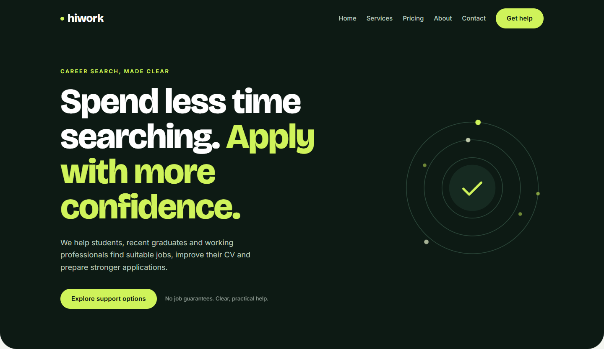
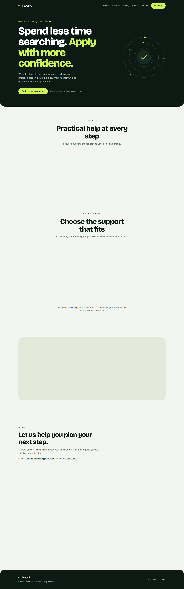
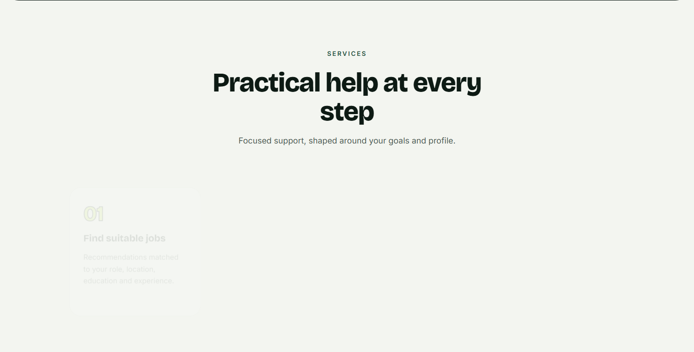
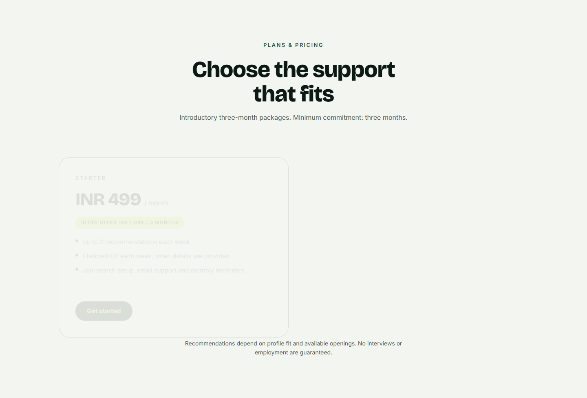
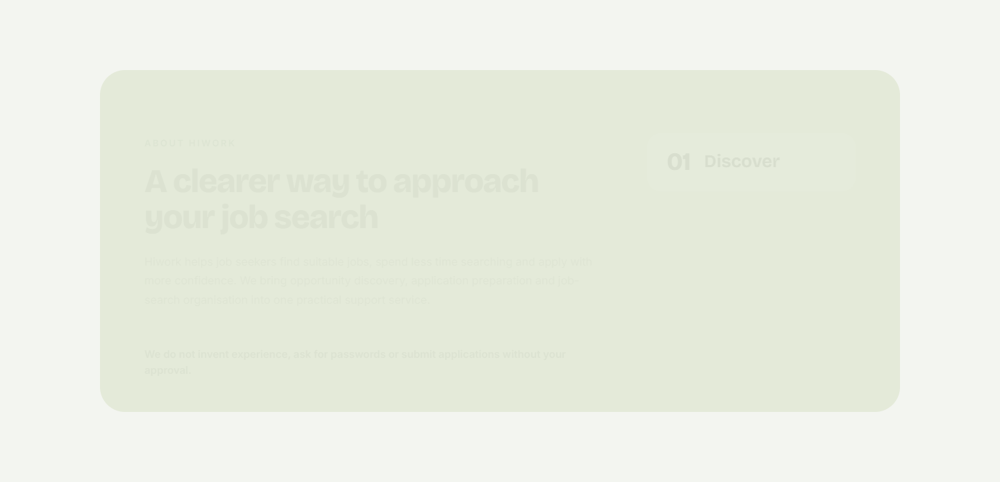
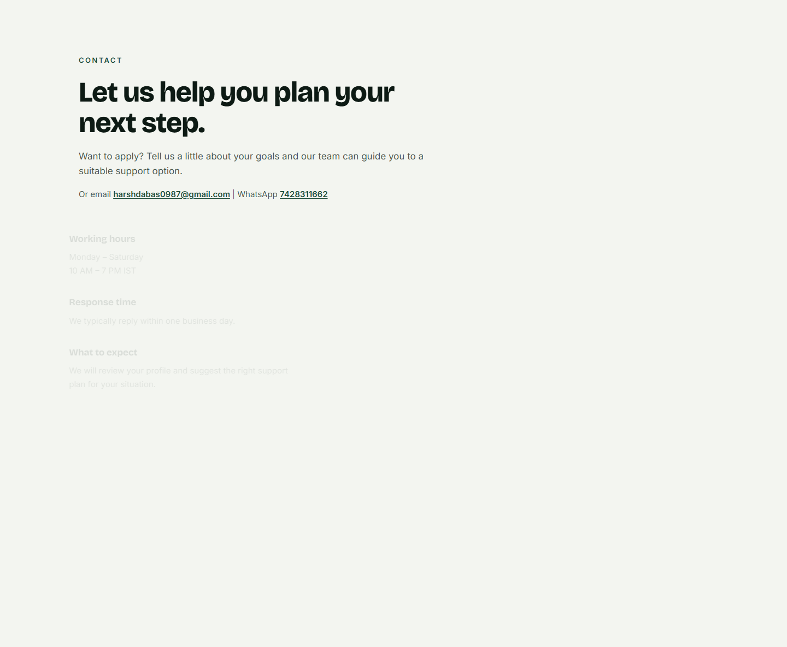
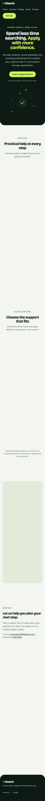
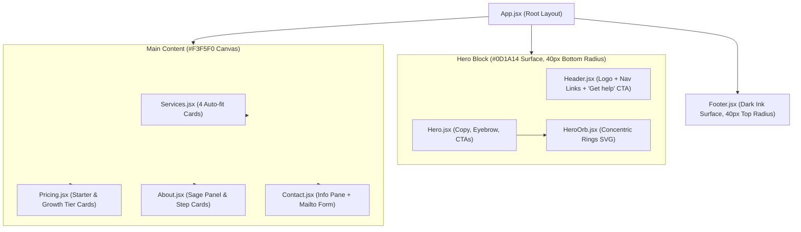
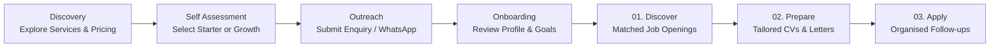
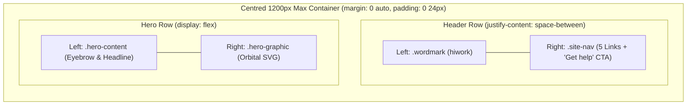

# Hiwork — Career Search Support

<p align="center">
  
</p>

<p align="center">
  <strong>Spend less time searching. Apply with more confidence.</strong><br>
  A modern, responsive marketing website for <strong>Hiwork</strong> — a career search support service for students, recent graduates, and working professionals.
</p>

<p align="center">
  
  
  
  
  
</p>

---

## 📑 Table of Contents

- [Overview](#-overview)
- [Visual Showcase (Pictorial Data)](#-visual-showcase-pictorial-data)
  - [Full Page Preview](#full-page-preview)
  - [Core Services Grid](#core-services-grid)
  - [Equal-Height Pricing Plans](#equal-height-pricing-plans)
  - [About Hiwork & Process Steps](#about-hiwork--process-steps)
  - [Contact & Enquiry System](#contact--enquiry-system)
  - [Mobile Responsive Layout](#mobile-responsive-layout)
- [Architecture & Diagrams](#-architecture--diagrams)
  - [Component Hierarchy](#component-hierarchy)
  - [User Journey & Process Pipeline](#user-journey--process-pipeline)
  - [Header & Hero Alignment Scheme](#header--hero-alignment-scheme)
- [Design Identity & System](#-design-identity--system)
  - [Color Palette](#color-palette)
  - [Typography & Scales](#typography--scales)
- [Tech Stack](#-tech-stack)
- [Project Structure](#-project-structure)
- [Getting Started](#-getting-started)
- [Accessibility & Motion](#-accessibility--motion)
- [License](#-license)

---

## 🌟 Overview

**Hiwork** provides personalized, practical job-search guidance without unrealistic guarantees or over-promising. The website is crafted with a bold dark-ink and lime visual identity, precision responsive layouts, smooth anchor scrolling, and accessible interactive states.

### Key Highlights
- **Single-page experience:** Effortless anchor navigation between Hero, Services, Pricing, About, and Contact.
- **Pixel-perfect layout:** Aligned container geometry (1200px cap with 24px side gutters).
- **Subtle motion design:** Framer Motion staggered entrance on load and a 40s concentric orbital SVG indicator that respects `prefers-reduced-motion`.
- **Zero backend required:** Contact enquiry form composes a structured `mailto:` payload directly for instant outreach.

---

## 📸 Visual Showcase (Pictorial Data)

### Full Page Preview

<p align="center">
  
</p>

---

### Core Services Grid

Four structured cards using an auto-fit responsive grid (`repeat(auto-fit, minmax(250px, 1fr))`) with large lime-outlined numbers, clear typography, and subtle hover lifts.

<p align="center">
  
</p>

| Step | Service Title | Scope |
|:---:|:---|:---|
| **01** | Find suitable jobs | Recommendations matched to your role, location, education and experience. |
| **02** | Build stronger applications | Tailored CVs and cover letters using your real skills and experience. |
| **03** | Improve your job-search setup | Role and platform planning, resume review and skill-gap analysis. |
| **04** | Stay organised and supported | Email or WhatsApp support, plus reminders for applications and follow-ups. |

---

### Equal-Height Pricing Plans

Side-by-side balanced cards for **Starter** and **Growth** tiers, stretched to matching heights with vertically pinned call-to-action buttons.

<p align="center">
  
</p>

- **Starter Card (Light):** White surface with crisp ink border, INR 499 / month (`INTRO OFFER INR 1,099 / 3 MONTHS`).
- **Growth Card (Dark):** Deep ink surface with lime highlights, INR 999 / month (`INTRO OFFER INR 2,499 / 3 MONTHS`).

---

### About Hiwork & Process Steps

Housed in a soft sage (`#E4EAD9`) panel with a 36px border radius, paired with a three-stage roadmap.

<p align="center">
  
</p>

> **Hiwork Commitment:** *"We do not invent experience, ask for passwords or submit applications without your approval."*

---

### Contact & Enquiry System

An interactive enquiry form with explicit labels, focus rings, direct email link, and direct WhatsApp chat integration (`+91 7428311662`).

<p align="center">
  
</p>

---

### Mobile Responsive Layout

Tested and optimized for small screens (360px – 480px) with gracefully wrapping navigation, readable font scales, and full $\ge 44\text{px}$ touch targets.

<p align="center">
  
</p>

---

## 📐 Architecture & Diagrams

### Component Hierarchy



---

### User Journey & Process Pipeline



---

### Header & Hero Alignment Scheme



---

## 🎨 Design Identity & System

### Color Palette

| Token | Hex Code | Visual Swatch | Role |
|:---|:---:|:---:|:---|
| `--color-bg` | `#F3F5F0` |  | Page background canvas |
| `--color-ink` | `#0D1A14` |  | Deep ink green for dark surfaces & primary headings |
| `--color-mid-green` | `#1F4D3A` |  | Secondary accents, eyebrow labels & links |
| `--color-lime` | `#CFF35A` |  | Primary brand highlight, CTA buttons & badges |
| `--color-sage` | `#E4EAD9` |  | Soft sage for the About section panel |
| `--color-border` | `#DDE3DD` |  | Subtle boundaries for cards & form fields |
| `--color-muted-light` | `#4A5750` |  | Readable body copy on light backgrounds |
| `--color-muted-dark` | `#B9C6BD` |  | Secondary text on dark surfaces |

### Typography & Scales

- **Display Font:** `Bricolage Grotesque` (weights: `500`, `700`, `800`) loaded via Google Fonts. Used for wordmark, main headlines, numbers, and plan prices.
- **Body Font:** `Inter` (weights: `400`, `500`, `600`). Used for navigation links, explanatory paragraphs, form inputs, and buttons.
- **Eyebrow Labels:** `13px`, font-weight `600`, letter-spacing `2.4px`, uppercase.

---

## 🛠 Tech Stack

- **Framework:** [React 19](https://react.dev/)
- **Build Tool:** [Vite 6](https://vitejs.dev/)
- **Animation:** [Framer Motion](https://www.framer.com/motion/) + Pure CSS `@keyframes`
- **Typography:** Google Fonts (`Bricolage Grotesque` & `Inter`)
- **Icons & Graphics:** Clean inline SVG

---

## 📂 Project Structure

```text
HIWork/
├── docs/
│   └── screenshots/              # Visual previews used in README
│       ├── about.png
│       ├── contact.png
│       ├── full-page.png
│       ├── hero.png
│       ├── mobile-preview.png
│       ├── pricing.png
│       └── services.png
├── public/
│   └── favicon.svg               # Hiwork branded favicon
├── src/
│   ├── components/
│   │   ├── About.css
│   │   ├── About.jsx             # Sage panel with 3 process cards
│   │   ├── Contact.css
│   │   ├── Contact.jsx           # Working hours, direct links & form
│   │   ├── Footer.css
│   │   ├── Footer.jsx            # Dark ink footer with 40px top radius
│   │   ├── Header.css
│   │   ├── Header.jsx            # 2-group layout (Logo + Nav group)
│   │   ├── Hero.css
│   │   ├── Hero.jsx              # Staggered entrance hero copy
│   │   ├── HeroOrb.css
│   │   ├── HeroOrb.jsx           # Concentric rings animated SVG
│   │   ├── Pricing.css
│   │   ├── Pricing.jsx           # Equal-height Starter & Growth cards
│   │   ├── Services.css
│   │   └── Services.jsx          # Auto-fit 4-card service grid
│   ├── App.css
│   ├── App.jsx                   # Dark hero block + main sections
│   ├── index.css                 # CSS variables, reset, container specs
│   └── main.jsx                  # Application entry point
├── index.html
├── package.json
└── vite.config.js
```

---

## 🚀 Getting Started

### Prerequisites
- **Node.js:** v18.0.0 or higher
- **npm:** v9.0.0 or higher

### Installation

1. **Clone the repository:**
   ```bash
   git clone https://github.com/iamritikarsh/HiWork.git
   cd HiWork
   ```

2. **Install dependencies:**
   ```bash
   npm install
   ```

3. **Start the local development server:**
   ```bash
   npm run dev
   ```
   Open [http://localhost:5173](http://localhost:5173) in your browser.

4. **Build for production:**
   ```bash
   npm run build
   ```

5. **Preview production build locally:**
   ```bash
   npm run preview
   ```

---

## ♿ Accessibility & Motion

- **Semantic Landmarks:** Proper usage of `<header role="banner">`, `<nav>`, `<main>`, `<section>`, and `<footer role="contentinfo">`.
- **Form Accessibility:** All inputs contain explicit `<label>` tags with matching `htmlFor` bindings.
- **Visible Focus Indicator:** High-contrast lime focus rings (`2.5px solid #CFF35A`) for keyboard navigators.
- **Prefers-Reduced-Motion:** Automatically disables SVG rotations and Framer Motion transitions for users requesting reduced motion.
- **Touch Targets:** All interactive anchors and buttons meet or exceed the standard $44\text{px} \times 44\text{px}$ minimum size.

---

## 📄 License

This project is licensed under the [MIT License](LICENSE).
